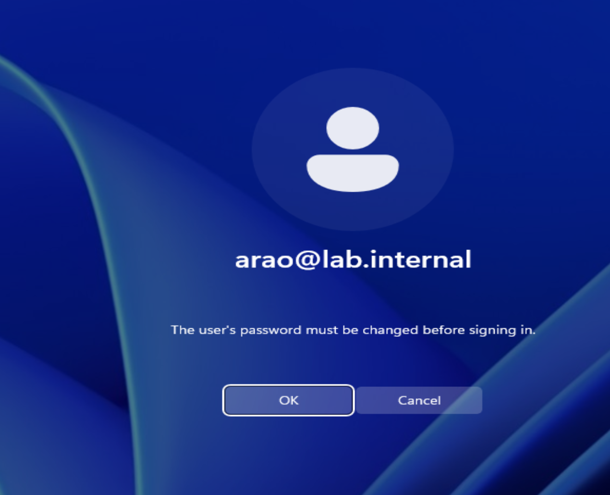
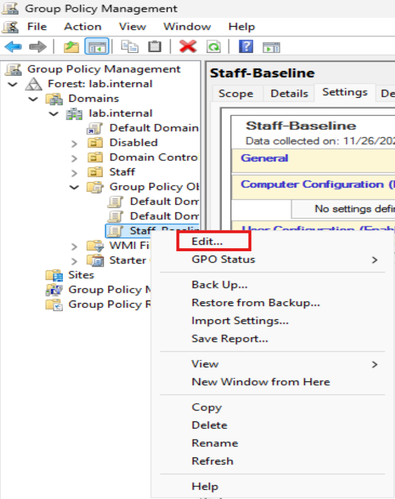
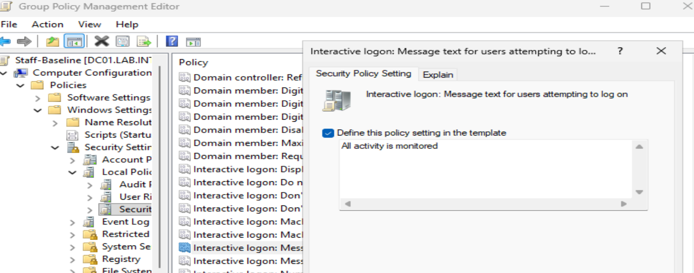

In this section we will explore a few basic Active directory administration commands to replicate real world uses.

## Password reset and required password change on logon:

This task is the most common task to occur as a helpdesk ticket.
```PowerShell
Set-ADAccountPassword -Identity arao -Reset -NewPassword (Read-Host -AsSecureString "New password")
Set-ADUser -Identity arao -ChangePasswordAtLogon $True

```

This is mostly used when a user forgets a password or loses access to their account.

Here is the screen of the user when the enter the new password:



## Find and unlock Locked account:

This is used when a user gets locked out from their account and need the account to be unlocked.
```PowerShell
Search-ADAccount -LockedOut
Unlock-ADAccount -Identity arao

```

## Disable or Re-enable an account:

This is used when an account needs to be disabled. A real world use case would be to disable an account if an employee leaves a company or if an old employee joins the company back.
```Powershell
Disable-ADAccount -Identity arao 
Enable-ADAccount -Identity arao

```

Here is what a disabled user will be shown if they try to login:


## Change a Users OU:

This is used when a user is shifting departments or is disabled and needs to be put in the disabled OU.
```PowerShell
Get-ADUser -Identity arao | Move-ADObject -TargetPath "OU=Disabled,DC=lab,DC=internal"

```

## Add or remove group member:

This is useful when you want to change a user to another group that may have access to different permissions.
```PowerShell
Add-ADGroupMember -Identity "IT-Support" -Members arao
Get-ADGroupMember -Identity "IT-Support"
Remove-ADGroupMember -Identity "IT-Support" -members arao

```

## Get report on users:

As part of Administration you may need to report/check accounts which haven't been logged into in a long time or which are disabled. Below is an example command on what a command to report/check user account may look like:
```PowerShell

Get-ADUser -Filter * -Properties LastLogonDate, Enabled | Select Name, Enabled, LastLogonDate

```

The output looks like the following:


## Change GPO setting and force the GPO to update:

This is used by Administrators who want to change the settings of the GPO and then have to push the update.

Note: Editing GPO is easier to do via the UI in most cases so we will be using the UI to change the GPO settings.

### Step 1:

On the DC, open the  Group policy management which you can find by searching "group policy management" in the search bar.

### Step 2:

Navigate using the left panel using the following path:

Forest->Domains->[Domain name]->Group Policy Objects->[GPO name]

Then right click the [GPO name]  and select edit as shown below:



### Step 3:

This will open the **Group Policy Management Editor** where we can edit the GPO settings.

For this example we will be adding a login banner.

Navigate to: Computer Configuration -> Policies -> Windows Settings -> Security Settings -> Local Policies -> Security Options

Here we edit "Interactive logon: Message title for users attempting to log on" to say "Authorized Access only" and edit "Interactive logon: Message text for users attempting to log on"\
to say "All activity is monitored" by double clicking the options and enabling "Define this policy setting in this template" and setting the value to what we want to be displayed as shown below:



### Step 4:

After making the changes we can Update the policy and see the result using the following commands:
```PowerShell
gpupdate /force
gpresult /r

```

Continue Lab:[Lab Architecture and Conclusion](./Lab%20Architecture%20and%20Conclusion.md)
