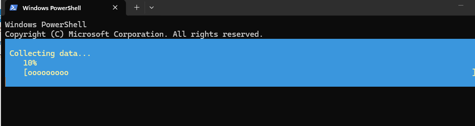
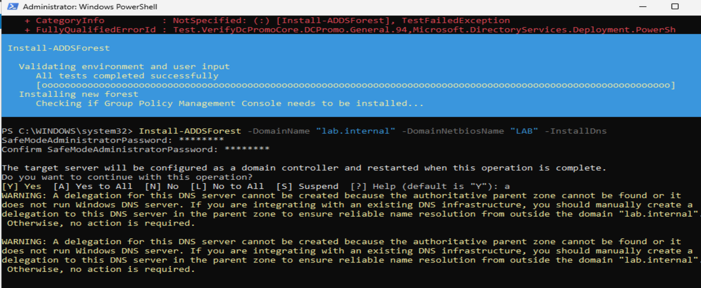
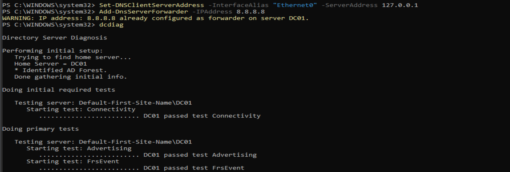

### Step 1:

After setting up the different VMs from the previous section we boot up DC01


Wait for the system to perform the initial setup which may take 5-10 minutes to complete.

### Step 2:

After booting up, the sever manager will open. If it doesn't it can be opened like any other application using windows search.

### Step 3:

As this server will be used for DNS we will have to assign it a static IP address.\
&#x20;If you need help setting a static IP follow this: [Set static IP for DNS](./Set%20static%20IP%20for%20DNS.md).

### Step 4:

Change the name of your server by executing the following command in PowerShell . (Note this will restart the VM after execution)
```PowerShell
Rename-Computer -NewName DC01 -Restart

```

### Step 5:

From this step  onwards we can either use the gui or the cli. We will be using the cli as it provides us with familiarity with the cli which is needed in the future for scripting and automation of tasks.


Now we will set the Roles and Features for the server:


To install Active directory Domain Service, Domain Name Service and management tools we will execute the following:
```PowerShell
Install-WindowsFeature AD-Domain-Services, DNS -IncludeManagementTools

```

This will start the installation as shown below:\
&#x20;

### Step 6:

Now we promote a new forest in the directory service using the following command:
```PowerShell
Install-ADDSForest -DomainName "lab.internal" -DomainNetbiosName "LAB" -InstallDns

```

Here we set the server as Domain Controller and set the name of the domain as lab.internal . The DomainNetbiosName Lab is set for older styles of logging in. We also install the DNS.


After executing the command you will be prompted to enter the SafeModeAdministratorPassword.


After entering password you will be prompted to continue the operation as it will restart the server. We chose [A] to say "yes to all" and wait for the computer to restart automatically after execution.&#x20;


\
&#x20;Note: If you get an error related to admin password set it using the command listed below :
```PowerShell
net user Administrator "[Password]"

```

&#x20;Replace "[Password]" with your password.

### Step 7:

After the restart we fix the DNS to point to itself and verify its health:
```PowerShell
Set-DnsClientServerAddress -InterfaceAlias "Ethernet0" -ServerAddresses 127.0.0.1

```

After setting the DNS to point to itself we add a Forwarder with the following command:
```PowerShell
Add-DnsServerForwarder -IPAddress 8.8.8.8

```

We verify the health of the domain controller by running the dcdiag command:
```PowerShell
dcdiag

```




We can see the command execute multiple tests and return if they passed.


Continue lab: [Setting Up OUs, Users, and Groups](./Setting%20Up%20OUs%2C%20Users%2C%20and%20Groups.md)
