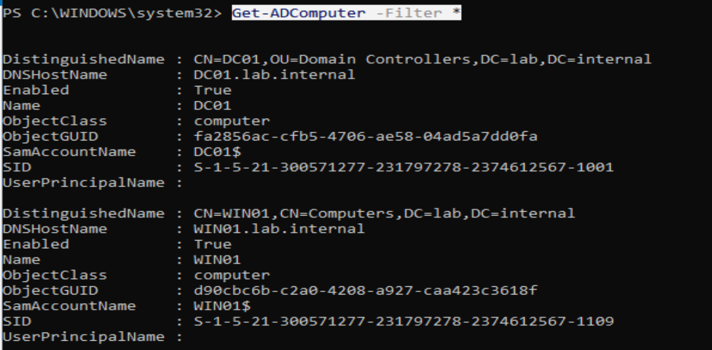

&#x20;We will be adding the Windows 11 device first.

## Step 1:

Open the WIN01 VM and complete Microsoft 11 Pro setup.

## Step 2:

Open Powershell on  the WIN01 VM and set the DC as the DNS server using the command:
```PowerShell
Set-DnsClientServerAddress -InterfaceAlias "Ethernet0" -ServerAddresses 10.99.99.10

```

## Step 3:

Next add the machine to the domain:
```PowerShell
Add-Computer -DomainName lab.internal -Credential LAB\Administrator -Restart

```

This will restart the PC .


After the restart on the login page select other users and enter [username]@[domain_name] and then enter the password.

## Step 4:

To confirm the computer has been added to your domain open Powershell on DC01 and execute the following command:
```PowerShell
Get-ADComputer -Filter *

```

You should see the server and the new PC like below:





Continue lab:[Basic Administration](./Basic%20Administration.md)
