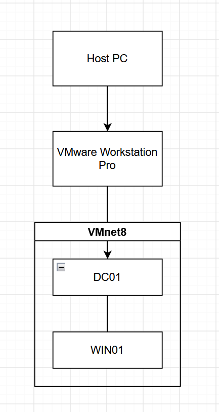

## Architecture:

Here the Host machine which in my case is Windows 11 is running VMware Workstation Pro in order to virtualize a network and two machines.\
DCO1 is running Windows Server 2025 version and functions as a Active Directory Domain Controller and DNS server.\
WIN01 is running Windows 11 and is meant to simulate a real world system handled by the DC01 Active Directory server.

## Conclusion:

This lab helps us learn the following:

- Setting up and performing initial configuration on an Active Directory DC and DNS server.
- Get information for reports involving different users and machines for parameters such as enabled and last logon.
- To configure/edit Group Policies and then deploy them.
