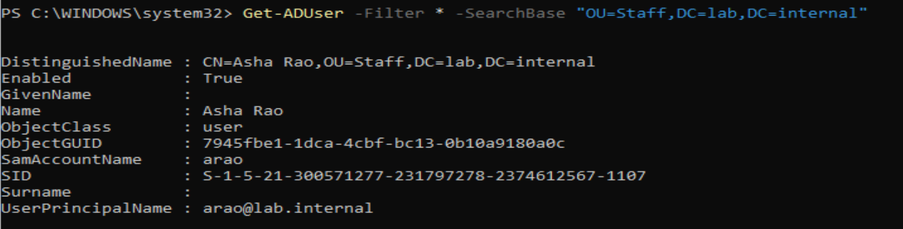
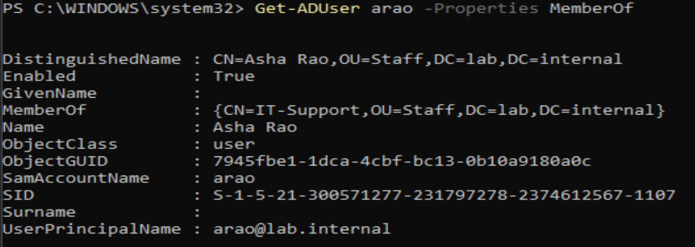
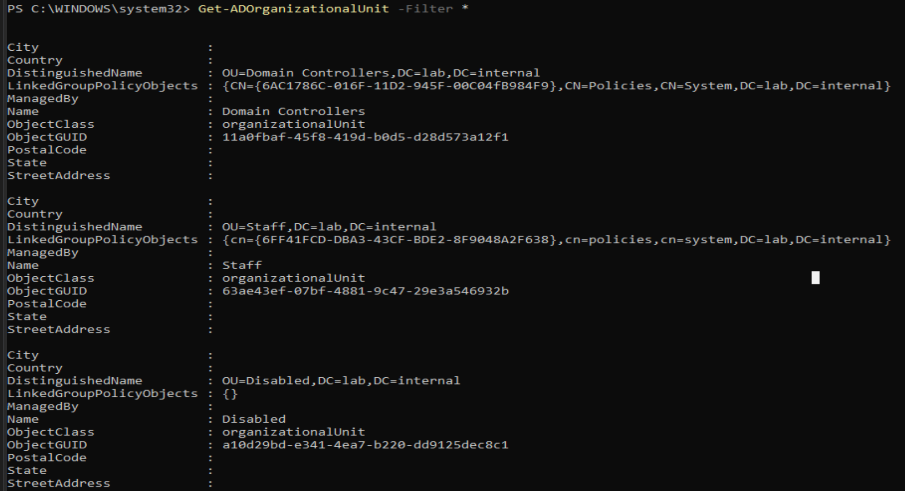
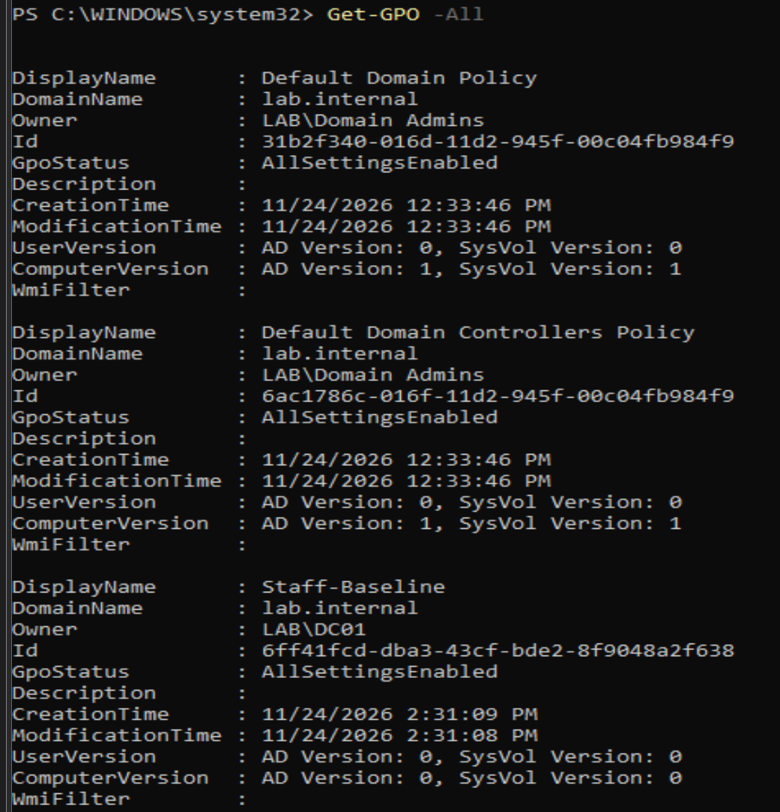

After we have finished setting up the domain controller and DNS we populate the domain with a basic organizational structure.


The structure consists of 2 **Organizational Units or OUs** called "Staff" and "Disabled", 1 new **user** called "Asha Rao", 1 **group** for "IT-support" and a **Group policy Object or GPO** .

## Step 1:

We first create the OUs using the New-ADOrganizationalUnit command:
```Powershell
New-ADOrganizationalUnit -Name "Staff" -Path "DC=lab,DC=internal"
New-ADOrganizationalUnit -Name "Disabled" -Path "DC=lab,DC=internal"

```

Note: In the path parameter the DC stands for Domain Component not Domain Controller.  We need to add a Domain component for each part of the Domain name.

## Step 2:

In this step we safely input the password and add a new user.


First we take the password as an input and store it in the $pw variable as a secure object which means the input is encrypted in the memory.
```PowerShell
$pw = Read-Host -AsSecureString "Password"

```

Next we add the user:
```PowerShell
New-ADUser -Name "Asha Rao" -SamAccountName arao -UserPrincipalName arao@lab.internal `-Path "OU=Staff,DC=lab,DC=internal" -AccountPassword $pw  -Enabled $true


```

note: If the password didn't meet the default requirements , the user will be created without a password.


In case of a failed password, delete the user and create the user again after giving a password that passes the default requirements.
```PowerShell
Remove-ADUser -Identity "arao"

```

use the following command to verify:
```PowerShell
Get-ADUser -Filter * -SearchBase "OU=Staff,DC=lab,DC=internal"

```

It should show the user as shown below:




## Step 3:

To create a group for IT support we use the New-ADGroup command:
```PowerShell
New-ADGroup -Name "IT-Support" -GroupScope Global -Path "OU=Staff,DC=lab,DC=internal"

```

To add the user "Asha Rao" we use the Add-ADGroupMember command:
```PowerShell
Add-ADGroupMember -Identity IT-Support -Members arao

```

## Step 4:

To create a Group Policy Object or GPO we use the New-GPO command:
```PowerShell
New-GPO -name "Staff-Baseline"

```

Then we link it to our existing group:
```PowerShell
New-GPLink -Name "Staff-Baseline" -Target "OU=Staff,DC=lab,DC=internal"

```

## Step 5:

Now to verify the user, group, GPOs and OUs were created we use the following commands:
```PowerShell
Get-ADUser arao -properties MemberOf
Get-ADOrganizationalUnit -Filter *
Get-GPO -All

```

Below we see the User:





Below we see the OUs:





Finally we see the GPO:





Continue lab:[Joining a client machine to domain](./Joining%20a%20client%20machine%20to%20domain.md)
