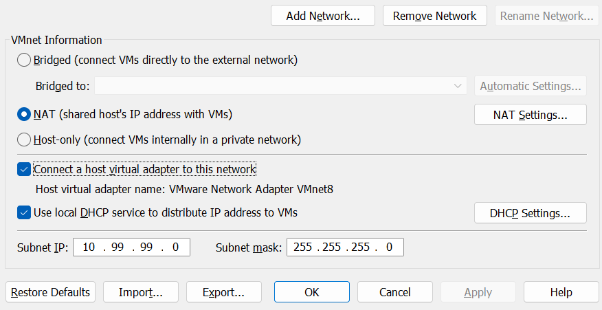

We start by first downloading the ISOs listed:

#### Windows AD:

We download the ISO for windows AD using the official website:\
&#x20;[Windows server 2025](https://www.microsoft.com/en-us/evalcenter/download-windows-server-2025)

#### Windows 11:

We use the media creation tool to create an ISO file\
&#x20;[Media creation tool](https://www.microsoft.com/en-ca/software-download/windows11)

### Setting up the VMs:

For this lab we will be using VMware Workstation Pro

We will be creating a new network by going to the virtual network adapter under the edit option on the toolbar.

First select Add Network and select VMnet8 and proceed.\
&#x20;The configuration is as follows:

When creating VMs use the following configurations during the setup:

| Name  | OS                             | Storage | Memory | Processors | Network Adapter |
| ----- | ------------------------------ | ------- | ------ | ---------- | --------------- |
| DC01  | Windows Server 2025 DataCenter | 60 GB   | 8 GB   | 2\*2       | Custom:VMnet8   |
| WIN01 | Windows 11 Pro                 | 60GB    | 8GB    | 2\*2       | Custom:VMnet8   |

Next section:[Deployment and initial configuration](./Deployment%20and%20initial%20configuration.md)
